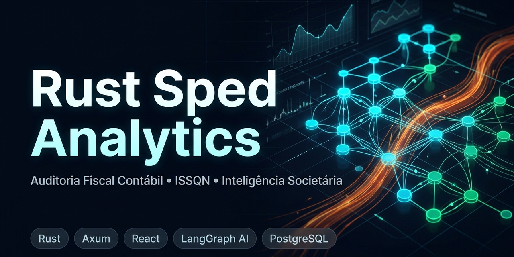

# Rust Sped Analytics

<p align="center">
  
</p>

> **Plataforma Corporativa de Alta Performance para Auditoria Fiscal Contábil (SPED ECD), Apuração de Base Tributável do ISSQN e Inteligência Societária Municipal.**

---

## Stack Tecnológica

<p align="left">
  
  
  
  
  
  
  
  
  
  
  
  
  
  
</p>

---

## Apresentação para o Auditor Fiscal Tributário Municipal

Caro(a) **Auditor(a) Fiscal de Tributos Municipais**,

A fiscalização eficiente do **ISSQN** (Imposto Sobre Serviços de Qualquer Natureza) e a identificação de fraudes fiscais demandam cada vez mais o cruzamento das declarações emitidas pelo contribuinte (NFS-e, PGMEI, DeSTDA) com as suas escriturações contábeis oficiais transmitidas à Receita Federal do Brasil.

O **SPED ECD** (*Escrituração Contábil Digital*) contém os lançamentos analíticos (Livro Diário) e sintéticos (Razão, Balancete e Demonstrações Contábeis) da pessoa jurídica. No entanto, arquivos de escrituração contábil frequentemente ultrapassam centenas de megabytes (100 MB a 2 GB), tornando a abertura e a auditoria em softwares convencionais (como Excel ou ferramentas legadas) inviáveis por esgotamento de memória.

### O que esta plataforma entrega para a sua rotina fiscal?

1. **Processamento em Segundos**: Arquivos SPED ECD de 500 MB+ são fatiados e gravados no banco de dados em poucos segundos usando streaming de baixo nível em **Rust**, sem travar a máquina.
2. **Apuração Automatizada da Receita de Serviços (ISSQN)**:
   - Extrai automaticamente as contas de receita a partir da **DRE** (Demonstração do Resultado do Exercício — Registro `J150`) e das Contas de Resultado (Registro `I355`).
   - Identifica se o contribuinte faturou receitas de prestação de serviços não declaradas nas notas fiscais do município.
   - Exporta relatórios analíticos em **planilhas Excel multi-aba** para anexar diretamente aos autos de infração e notificações fiscais.
3. **Rede Societária Municipal & Grupos Econômicos (Rede CNPJ / Turmalina)**:
   - Identifica em até 10 camadas de profundidade se a empresa fiscalizada possui sócios em comum, empresas coligadas ou interpostas pessoas ("laranjas").
   - Cruza automaticamente os sócios com bases nacionais de sanções: **PEP** (Pessoas Expostas Politicamente), **CEIS**, **CEPIM**, **CNEP** e **Dívida Ativa da PGFN**.
   - Fundamental para caracterização de grupo econômico de fato e desconsideração da personalidade jurídica.
4. **Copiloto de Inteligência Artificial Especialista em SPED**:
   - Faça perguntas em português claro (*ex: "Qual foi o faturamento bruto e a receita de serviços no primeiro trimestre de 2025?"*).
   - O assistente consulta a base de dados do SPED e gera relatórios com gráficos dinâmicos para subsidiar seu parecer fiscal.

---

## Guia Rápido: Como Executar a Aplicação Localmente

Você não precisa ser um programador experiente para rodar e testar esta plataforma. Desenvolvemos comandos simplificados via **`make`** que preparam todo o ambiente automaticamente.

### 1. Pré-requisitos Básicos no seu Computador
* **Docker** e **Docker Compose** instalados e em execução.
* Ferramenta de linha de comando **`make`** (nativa no Linux/macOS ou via WSL2 no Windows).
* **Python 3** (para o gerador de arquivos de teste SPED).

---

### 2. Iniciando Todos os Serviços

Abra o terminal na pasta do projeto e execute:

```bash
make start
```

> **O que esse comando faz nos bastidores?**
> 1. Cria as pastas de trabalho (`media/ecd_stage/` para arquivos aguardando, processados e com erro).
> 2. Configura automaticamente o arquivo de ambiente `.env` com configurações padrão seguras.
> 3. Inicializa todos os containers em segundo plano:
>    - **PostgreSQL 16**: Banco de dados relacional com o schema oficial do SPED ECD.
>    - **Redis 7**: Fila assíncrona de alto desempenho.
>    - **Server (Rust / Axum)**: API central de autenticação e consultas.
>    - **Worker (Rust)**: Motor de parsing veloz que processa as escriturações.
>    - **AI Gateway (FastAPI)**: Assistente cognitivo com LangChain/LangGraph.
>    - **Web (React SPA)**: Painel web acessível no seu navegador.

Para verificar se todos os serviços estão saudáveis:
```bash
make status
```

---

### 3. Gerando Arquivos SPED Fictícios para Teste de Auditoria

Para experimentar a plataforma sem precisar utilizar arquivos reais de contribuintes em fase de homologação, utilize o gerador de massa de dados oficial do projeto:

```bash
make generate-mock
```
*(ou se preferir executar diretamente com Python: `python3 scripts/gerar_massa_sped.py`)*

Esse script gera automaticamente na pasta `tests/fixtures/sped/` uma coleção de arquivos SPED válidos:
* **`ecd_minimo_pva.txt`**: Estrutura mínima compatível com o Programa Validador e Assinador da RFB (PVA).
* **`ecd_homologacao_completa.txt`**: Arquivo completo contendo Balanço Patrimonial (`J100`), DRE com Receita de Serviços (`J150`) e Balancete Analítico (`I155`).
* **`ecd_substituta.txt`**: Escrituração retificadora que substitui a anterior (testando controle de escrituração ativa).
* **`ecd_volume_10k.txt`**: Arquivo com 10.000 lançamentos contábeis para teste de velocidade e estresse.

> **Nota de Conformidade Legal**: Todos os CNPJs gerados possuem **Dígito Verificador matematicamente válido** (módulo 11), codificação `Windows-1252` e totalizadores do Bloco 9 (`9900`, `9990`, `9999`) rigorosamente balanceados.

---

### 4. Acessando a Interface no Navegador

Após iniciar o sistema, abra seu navegador de internet no endereço:

**[http://localhost:3000](http://localhost:3000)**

#### Roteiro Prático de Auditoria na Interface:

1. **Ingestão de Escrituração**:
   - Acesse o menu **Ingestão**.
   - Arraste para o campo de upload o arquivo `tests/fixtures/sped/ecd_homologacao_completa.txt`.
   - Acompanhe o processamento do arquivo em tempo real pelo log de eventos na tela.
2. **Auditoria Contábil**:
   - Acesse o menu **Auditoria**.
   - Digite o CNPJ da empresa presente no arquivo ou pesquise na listagem.
   - Visualize as abas oficiais:
     - **0000**: Dados cadastrais da empresa e período da escrituração.
     - **J100**: Balanço Patrimonial (Ativo, Passivo e Patrimônio Líquido).
     - **J150**: DRE com destaque automático para as contas de **Receita de Serviços**.
     - **I155**: Balancete mensal analítico com saldos iniciais, débitos, créditos e saldos finais.
   - Clique em **Exportar Excel** para baixar o relatório completo consolidado em `.xlsx`.
3. **Inteligência Societária (GRC / Turmalina)**:
   - Acesse o menu **Rede Societária**.
   - Insira um CNPJ para visualizar o grafo interativo de relacionamentos, sócios comuns e participações societárias.
   - Verifique alertas de restrições ou sanções governamentais associadas aos sócios.
4. **Copiloto de IA**:
   - Abra a gaveta do **Copiloto de IA** e faça perguntas analíticas sobre os números auditados.

---

### 5. Acompanhando Logs do Sistema

Se desejar inspecionar o que está acontecendo no processamento em tempo real:

```bash
# Ver logs gerais de todos os serviços
make logs

# Ver apenas os logs do processador de SPED (Worker)
make logs-worker

# Ver apenas os logs do Servidor de APIs
make logs-server
```
*(Para sair da tela de logs a qualquer momento, pressione `Ctrl + C`)*

---

### 6. Como Parar ou Reiniciar o Sistema

Quando terminar os seus testes ou expediente de auditoria:

```bash
# Para pausar a execução
make stop

# Para reiniciar caso precise
make restart

# Para limpar o ambiente completamente (incluindo dados do banco)
make clean-all
```

---

## Tabela de Referência de Comandos `make`

| Comando | Finalidade para o Auditor / Desenvolvedor |
| :--- | :--- |
| `make help` | Exibe a lista completa de comandos explicados |
| `make start` | Sobe a aplicação inteira em Docker em background |
| `make stop` | Para com segurança todos os serviços |
| `make restart` | Reinicia todos os containers |
| `make status` | Informa se os serviços e bancos de dados estão online |
| `make generate-mock`| Cria os arquivos de teste SPED na pasta `tests/fixtures/sped/` |
| `make logs` | Mostra os registros de processamento e auditoria em tempo real |
| `make package` | Gera o pacote compactado de distribuição (`dist/*.tar.gz`) |
| `make test` | Roda a bateria de testes automatizados de validação contábil |
| `make db-shell` | Abre o terminal interativo do PostgreSQL (`psql`) |

---

## Estrutura de Pastas e Módulos

```text
rust-sped-analitycs/
├── Makefile                       # Comandos simplificados de execução, build e testes
├── Cargo.toml                     # Configuração central do projeto Rust (workspace)
├── AGENTS.md                      # Protocolo de concorrência e guia de agentes de IA
├── docker-compose.yml             # Orquestrador dos containers (Postgres, Redis, Web, API)
├── apps/
│   ├── server/                    # API Axum REST e Server-Sent Events (SSE)
│   ├── worker/                    # Motor de processamento rápido dos arquivos SPED
│   └── web/                       # Frontend SPA (React + Tailwind + Shadcn UI)
├── crates/
│   ├── ecd-domain/                # Estruturas oficiais da Receita Federal (Registros SPED)
│   ├── ecd-parser/                # Leitor de alta velocidade com memória virtual (memmap2)
│   ├── ecd-fiscal/                # Apuração da DRE, termos de receita e gerador de Excel
│   ├── ecd-graph/                 # Grafo de sócios e busca de grupos econômicos
│   ├── ecd-analytics/             # Estatísticas de CNAE, porte e cache em memória
│   └── ecd-storage/               # Acesso ao banco de dados PostgreSQL
├── services/
│   └── ai-gateway/                # Copiloto de IA em Python (FastAPI + LangGraph)
├── scripts/
│   ├── gerar_massa_sped.py        # Gerador oficial de arquivos SPED sintéticos
│   └── package.sh                 # Script de empacotamento para distribuição
└── tests/fixtures/sped/           # Pasta onde os arquivos SPED gerados são armazenados
```

---

## Desenvolvimento e Contribuição

Para orientações sobre desenvolvimento com múltiplos agentes de IA em paralelo e especificações técnicas de cada módulo, consulte [`AGENTS.md`](AGENTS.md) e [`TASKS.md`](TASKS.md).
