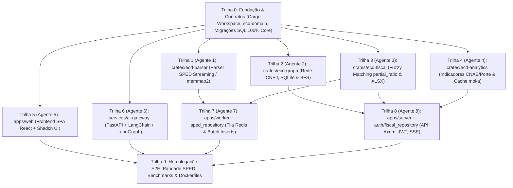

# Quadro de Tarefas de Implementação Paralela (TASKS Board)

> **Legenda de Status**:
> - `[ ]` Pendente / Não iniciada
> - `[~]` Em andamento (Reivindicada por Agente)
> - `[x]` Concluída e testada

---

## Grafo de Dependências entre Trilhas (DAG)

> **Nota sobre Paralelismo**:
> - **Onda 1 (6 Agentes em Paralelo)**: Trilhas 1, 2, 3, 4, 5 e 6 são 100% independentes e podem rodar simultaneamente logo após a Trilha 0.
> - **Onda 2 (2 Agentes em Paralelo)**: Trilhas 7 (`apps/worker` + `crates/ecd-storage/src/sped_repository.rs`) e 8 (`apps/server` + `crates/ecd-storage/src/{auth,fiscal}_repository.rs`) também rodam em paralelo entre si, pois compartilham apenas os contratos imutáveis `ImportSpedJobPayload` e `JobStatusEvent` já definidos em `crates/ecd-domain`.

---

## Trilha 0: Fundação, Contratos & Schema (Concluída)
- [x] **TASK-001**: Inicializar workspace Cargo modular com 6 crates e 2 apps executáveis.
- [x] **TASK-002**: Definir structs oficiais do SPED ECD (`core`) com 100% das tabelas/colunas (`0000`, `I010`, `I030`, `I050`, `I051`, `I052`, `I053`, `RegI050`, `I150`, `I155`, `RegI355`, `J005`, `J100`, `RegJ150`, `J210`, `J215`) e contratos Redis em `ecd-domain`.
- [x] **TASK-003**: Criar migração SQL inicial do PostgreSQL (`migrations/0001_initial_schema.sql`) preservando nomes reais (`regi050_plano_contas`, `regi355_detalhes_contas_resultado`, `regj150_demonstracao_resultado`, `plano_contas_base`).
- [x] **TASK-004**: Pré-declarar submódulos isolados em `crates/ecd-storage` (`sped_repository`, `fiscal_repository`, `auth_repository`) e configurar `docker-compose.yml`.

---

## Onda 1: Trilhas Paralelas Independentes (Agentes 1 a 6)

### Trilha 1: Motor de Parsing SPED (`crates/ecd-parser`) — [Agente 1]
- [ ] **TASK-101**: Implementar `SpedStreamReader` com `memmap2` e fatiamento zero-copy de registros em `crates/ecd-parser/src/reader.rs`.
- [ ] **TASK-102**: Implementar decodificadores tipados para os Blocos `0000`, `I010`, `I030`, `I050`, `I051`, `I052`, `I053`, `I150` e `I155` (incluindo consolidação em `RegI050`).
- [ ] **TASK-103**: Implementar decodificadores tipados para os Blocos `I355` (`RegI355`), `J005`, `J100`, `J150` (`RegJ150`), `J210` e `J215`.
- [ ] **TASK-104**: Criar suite de testes unitários com fixture SPED (codificação `WINDOWS_1252`, datas `DDMMAAAA` e decimais com vírgula).

### Trilha 2: Motor de Grafos da Rede CNPJ (`crates/ecd-graph`) — [Agente 2]
- [ ] **TASK-201**: Implementar pool de conexões SQLite thread-safe (`r2d2_sqlite`) em modo `query_only = ON` com pragmas `mmap_size` e `cache_size`.
- [ ] **TASK-202**: Implementar algoritmo BFS de expansão em N camadas (1 a 10) usando `petgraph::UnGraph` e poda `kLimiteCamada = 1000`.
- [ ] **TASK-203**: Implementar cruzamento atômico com sanções da base `links.db` (PEP, CEIS, CEPIM, CNEP, Dívida PGFN).
- [ ] **TASK-204**: Implementar busca de menor caminho (`petgraph::algo::dijkstra`) entre duas entidades corporativas ou sócios.
- [ ] **TASK-205**: Criar testes unitários com banco SQLite em memória/fixture validando prevenção de ciclos e limites de camada.

### Trilha 3: Motor Fiscal & Apuração de Receitas (`crates/ecd-fiscal`) — [Agente 3]
- [ ] **TASK-301**: Implementar extrator de receitas (`crates/ecd-fiscal/src/revenue.rs`) com `partial_ratio >= 0.80`, catálogo de 24 termos e os 12 filtros negativos de `RegJ150` e `RegI355`.
- [ ] **TASK-302**: Implementar cálculo consolidado de `receita_bruta`, `receita_servico`, `outras_receitas` e `receita_acumulada`.
- [ ] **TASK-303**: Implementar gerador de planilhas Excel multi-aba (`crates/ecd-fiscal/src/xlsx.rs` com `umya-spreadsheet`) para blocos `0000`, `J100`, `J150` e `I155`.
- [ ] **TASK-304**: Criar testes unitários garantindo paridade aritmética com `apps/fiscal/utils.py` e `apps/fiscal/utils_recfuze.py`.

### Trilha 4: Motor de Indicadores Econômicos (`crates/ecd-analytics`) — [Agente 4]
- [ ] **TASK-401**: Implementar agregador de indicadores cadastrais e econômicos (CNAE Top 15, Porte Empresarial, Regime Tributário Simples/MEI, Capital Social Médio e UF/Município) sobre SQLite/PostgreSQL.
- [ ] **TASK-402**: Implementar cache em memória assíncrono com `moka::future::Cache` e TTL configurável.
- [ ] **TASK-403**: Criar testes unitários validando cálculos percentuais e invalidação/hit de cache.

### Trilha 5: Frontend SPA React + Shadcn UI (`apps/web`) — [Agente 5]
- [ ] **TASK-501**: Configurar layout base (`AppLayout`, `Sidebar`), tema Tailwind/Shadcn UI, TanStack Router e cliente HTTP com `withCredentials: true`.
- [ ] **TASK-502**: Implementar tela de Ingestão (`FileDropzone`, `ImportJobsTable` e `LiveLogDrawer` via `EventSource` SSE).
- [ ] **TASK-503**: Implementar tela de Auditoria por CNPJ (`CnpjSearchBar` com validação DV, abas `0000`/`J100`/`J150`/`I155` virtualizadas com TanStack Table e exportação XLSX).
- [ ] **TASK-504**: Implementar tela de Rede Societária GRC (`NetworkGraphCanvas` com Vis-Network, controle de 1-10 camadas, busca de menor caminho e `NodeDetailDrawer` com badges sancionatórios) e Dashboard de Indicadores Econômicos.
- [ ] **TASK-505**: Implementar Copiloto de IA (`AiChatDrawer` com Markdown e `DynamicChartRenderer` com Recharts).

### Trilha 6: AI Gateway com LangChain (`services/ai-gateway`) — [Agente 6]
- [ ] **TASK-601**: Configurar FastAPI, Pydantic Settings e cliente LLM LangChain (`ChatGroq` / `ChatOpenAI`).
- [ ] **TASK-602**: Implementar catálogo de ferramentas `@tool` (`buscar_dados_cadastrais`, `apurar_demonstrativo_dre`, `analisar_grafo_societario`, `consultar_indicadores_setor`, `construir_grafico_dashboard`).
- [ ] **TASK-603**: Implementar grafo ReAct com LangGraph retornando `ChatResponse` (relatório Markdown + `ChartSpec` JSON) e streaming SSE.
- [ ] **TASK-604**: Criar testes unitários e de contrato com `pytest` validando o schema JSON dos gráficos.

---

## Onda 2: Trilhas de Integração Backend (Agentes 7 e 8 em Paralelo)

### Trilha 7: Worker Assíncrono & Batch Storage (`apps/worker` + `sped_repository.rs`) — [Agente 7]
- [ ] **TASK-701**: Implementar `crates/ecd-storage/src/sped_repository.rs` com inserções em lote (`QueryBuilder` de 5.000 linhas) em transação atômica para todas as tabelas `core_*` e `reg*`.
- [ ] **TASK-702**: Implementar consumer Redis (`BRPOP ecd:queue:jobs`) em `apps/worker` com reconexão automática.
- [ ] **TASK-703**: Integrar pipeline `memmap2` (`ecd-parser`) -> `sped_repository` -> `ecd-fiscal` (`resultados_exercicio`) e exclusão lógica de escriturações substituídas (`cod_hash_sub`).
- [ ] **TASK-704**: Publicar eventos `JobStatusEvent` no canal Redis Pub/Sub (`ecd:events:status`) e mover arquivo para `processados/` ou `erro/`.

### Trilha 8: Servidor HTTP Axum (`apps/server` + `auth/fiscal_repository.rs`) — [Agente 8]
- [ ] **TASK-801**: Implementar `auth_repository.rs` e autenticação Argon2id + JWT em cookies `HttpOnly; Secure; SameSite=Lax` (`/api/auth/*`) e middleware RBAC.
- [ ] **TASK-802**: Implementar upload multipart streaming (`/api/importacoes/upload`) gravando em `media/ecd_stage/aguardando/` e publicando `ImportSpedJobPayload` no Redis.
- [ ] **TASK-803**: Implementar endpoint Server-Sent Events (`/api/jobs/{id}/stream`) subscrito no canal Redis `ecd:events:status`.
- [ ] **TASK-804**: Implementar `fiscal_repository.rs` e rotas de consulta contábil/DRE (`/api/fiscal/*`), grafos (`/api/grc/*`), indicadores (`/api/indicadores/*`) e proxy reverso para o AI Gateway (`/api/ai/chat`).

---

## Onda 3: Homologação Final & Empacotamento

### Trilha 9: Homologação E2E, Paridade & Docker
- [ ] **TASK-901**: Criar `Dockerfile.server`, `Dockerfile.worker`, `apps/web/Dockerfile` e `services/ai-gateway/Dockerfile` multi-stage.
- [ ] **TASK-902**: Executar bateria de testes de paridade (`tests/parity/test_sped_parity.py`) comparando saídas do Django legado vs Rust.
- [ ] **TASK-903**: Executar benchmarks de tempo e memória RSS com arquivos SPED de 100MB, 500MB e 1GB+.
