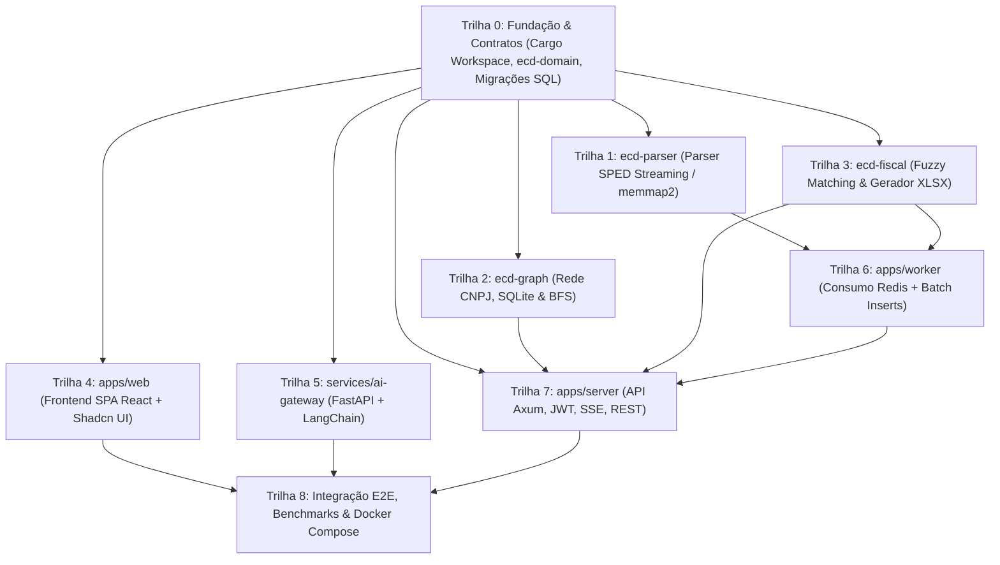

# Quadro de Tarefas de Implementação Paralela (TASKS Board)

> **Legenda de Status**:
> - `[ ]` Pendente / Não iniciada
> - `[~]` Em andamento (Reivindicada por Agente)
> - `[x]` Concluída e testada

---

## Grafo de Dependências entre Trilhas (DAG)

---

## Trilha 0: Fundação, Contratos & Schema (Bloqueante)
- [x] **TASK-001**: Inicializar workspace Cargo modular com 6 crates e 2 apps executáveis.
- [x] **TASK-002**: Definir structs oficiais do SPED ECD (`core`) e tipos centrais em `ecd-domain`.
- [x] **TASK-003**: Criar migração SQL inicial do PostgreSQL (`migrations/0001_initial_schema.sql`).
- [x] **TASK-004**: Criar arquivo `docker-compose.yml` e documentação de arquitetura.

---

## Trilhas Paralelas Independentes (Podem rodar simultaneamente!)

### Trilha 1: Motor de Parsing SPED (`ecd-parser`) — [Agente 1]
- [ ] **TASK-101**: Implementar `SpedStreamReader` com `memmap2` e fatiamento zero-copy de registros em `crates/ecd-parser`.
- [ ] **TASK-102**: Implementar decodificadores específicos para Blocos `0000`, `I010`, `I030`, `I050`, `I051`, `I052`, `I150`, `I155`.
- [ ] **TASK-103**: Implementar decodificadores específicos para Blocos `I355`, `J005`, `J100`, `J150`, `J210`, `J215`.
- [ ] **TASK-104**: Criar suite de testes unitários com fixture de arquivo SPED real de teste e validação de contagem de linhas.

### Trilha 2: Motor de Grafos da Rede CNPJ (`ecd-graph`) — [Agente 2]
- [ ] **TASK-201**: Implementar pool de conexões SQLite thread-safe (`r2d2_sqlite`) em modo `query_only = ON`.
- [ ] **TASK-202**: Implementar algoritmo BFS de expansão em N camadas (1 a 10) usando `petgraph::UnGraph`.
- [ ] **TASK-203**: Implementar cruzamento com sanções da base `links.db` (PEP, CEIS, CEPIM, CNEP, Dívida PGFN).
- [ ] **TASK-204**: Implementar busca de menor caminho (Dijkstra) entre duas entidades corporativas (`camadasRede_caminhos`).
- [ ] **TASK-205**: Criar testes unitários simulando consultas com banco SQLite de fixture.

### Trilha 3: Motor Fiscal & Apuração de Receitas (`ecd-fiscal`) — [Agente 3]
- [ ] **TASK-301**: Implementar normalizador de texto contábil e fuzzy matching com `strsim` (Damerau-Levenshtein $\ge 0.80$).
- [ ] **TASK-302**: Implementar classificador de receitas a partir dos registros `J150` (DRE) e `I355`.
- [ ] **TASK-303**: Implementar gerador de planilhas Excel multi-aba (`umya-spreadsheet`) com formatações de moeda e data.
- [ ] **TASK-304**: Criar testes unitários comparando saídas com as regras do `apps/fiscal/utils.py`.

### Trilha 4: Frontend SPA React + Shadcn UI (`apps/web`) — [Agente 4]
- [ ] **TASK-401**: Configurar Vite, Tailwind CSS, Shadcn UI base components e roteador TanStack Router.
- [ ] **TASK-402**: Implementar tela de Ingestão (`FileDropzone`, tabela de status com TanStack Table e logs SSE).
- [ ] **TASK-403**: Implementar tela de Auditoria por CNPJ (`CnpjSearchBar`, abas de blocos SPED, visualização DRE/Balanço).
- [ ] **TASK-404**: Implementar tela de Rede CNPJ (`NetworkGraphCanvas` com Vis-Network, filtro de camadas e alertas visuais).
- [ ] **TASK-405**: Implementar drawer lateral do Copiloto de IA (`AiChatDrawer` com renderizador dinâmico Recharts).

### Trilha 5: AI Gateway com LangChain (`services/ai-gateway`) — [Agente 5]
- [ ] **TASK-501**: Configurar ambiente FastAPI, Pydantic settings e cliente LangChain Groq (Llama 3.1).
- [ ] **TASK-502**: Implementar catálogo de ferramentas (*Tool Calling*) para consulta de DRE, Balanço, Rede CNPJ e CNAE.
- [ ] **TASK-503**: Implementar loop de agente com LangGraph gerando saídas estruturadas em Markdown e ChartSpecs JSON.
- [ ] **TASK-504**: Criar testes de integração simulando consultas de linguagem natural e validando schema dos gráficos.

---

## Trilhas de Integração & Persistência

### Trilha 6: Worker Assíncrono (`apps/worker` & `ecd-storage`)
- [ ] **TASK-601**: Implementar consumer de fila Redis com tratamento de reconexão e backoff.
- [ ] **TASK-602**: Integrar `ecd-parser` com `SQLx` para batch inserts de 5.000 linhas nas tabelas `core_*`.
- [ ] **TASK-603**: Implementar cálculo de encerramento de lote, atualização de `resultados_exercicio` e refresh de views.
- [ ] **TASK-604**: Implementar emissão de eventos em tempo real via Redis Pub/Sub (`ecd:events:status`).

### Trilha 7: Servidor HTTP Axum (`apps/server`)
- [ ] **TASK-701**: Implementar autenticação JWT com Argon2id e gravação em cookies HttpOnly (`/api/auth/*`).
- [ ] **TASK-702**: Implementar endpoint de upload multipart streaming de arquivos SPED (`/api/importacoes/upload`).
- [ ] **TASK-703**: Implementar endpoint Server-Sent Events (`/api/jobs/{id}/stream`) subscrito no Redis Pub/Sub.
- [ ] **TASK-704**: Implementar endpoints de consulta fiscal, exportação XLSX e rede societária GRC.
- [ ] **TASK-705**: Implementar proxy reverso streaming para o AI Gateway (`/api/ai/chat`).

---

## Trilha 8: Homologação Final & Empacotamento
- [ ] **TASK-801**: Dockerfiles multi-stage para `server`, `worker`, `web` e `ai-gateway`.
- [ ] **TASK-802**: Bateria de testes de paridade comparando resultados de 10 arquivos SPED com o Django legado.
- [ ] **TASK-803**: Benchmarks comparativos de tempo de parsing e uso de memória RAM.
