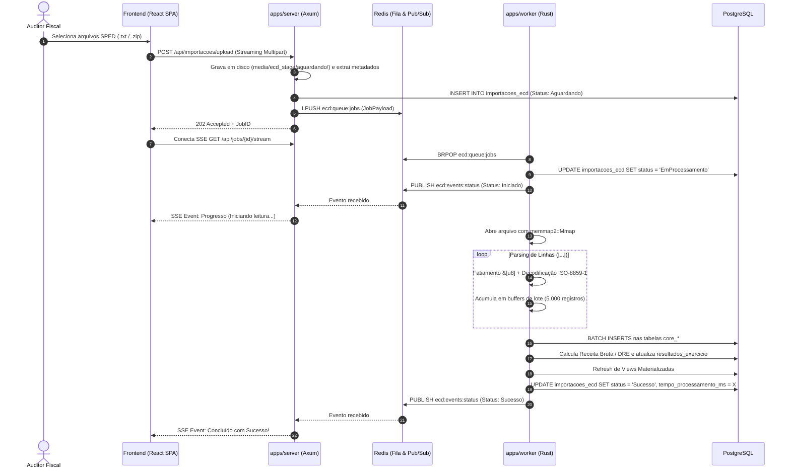

```mermaid
graph TD
    User([Auditor Fiscal / Usuário]) <-->|HTTPS| WebApp[apps/web: SPA React + Shadcn UI]
    WebApp <-->|REST API & SSE / JSON| ApiServer[apps/server: Axum Server]
    
    ApiServer -->|Uploads de Arquivos| StorageDisk[(Disco Local: media/ecd_stage)]
    ApiServer -->|Enfileiramento de Jobs| RedisQueue[(Redis: Fila & Pub/Sub)]
    ApiServer <-->|Auth, Consultas, DRE| Postgres[(PostgreSQL: Core ECD & Suporte)]
    ApiServer <-->|Proxy Conversacional| AIGateway[services/ai-gateway: FastAPI + LangChain]
    
    AIGateway <-->|Tool Calling / REST| ApiServer
    
    RedisQueue -->|Consumo de Tarefas| Worker[apps/worker: Background Engine]
    Worker -->|Leitura Zero-Copy| StorageDisk
    Worker -->|Batch Inserts em Massa| Postgres
    Worker -->|Consultas de Grafos| SqliteBases[(SQLite Local: cnpj.db, rede.db, links.db)]
    Worker -->|Notificações de Progresso| RedisQueue
```

# Especificação Técnica: Rearquitetura do ECD Analytics (Rust + React SPA + AI Gateway)

- **Data**: 2026-10-24
- **Status**: Aprovado para Planejamento de Implementação
- **Autores**: Equipe de Arquitetura & Engenharia de Software

---

## 1. Visão Geral e Objetivos do Sistema

O **ECD Analytics** é uma plataforma corporativa de auditoria contábil, apuração fiscal e inteligência de relacionamentos societários baseada em dados públicos da Receita Federal do Brasil (RFB) e arquivos da Escrituração Contábil Digital (SPED ECD).

O sistema legado em Django/Python enfrenta limitações críticas de throughput e consumo de memória durante a ingestão de grandes volumes de arquivos SPED (frequentemente entre 100 MB e 2 GB por arquivo), lentidão em consultas recursivas de grafos societários e acoplamento na interface renderizada pelo servidor (SSR).

### 1.1 Objetivos Centrais da Nova Arquitetura
1. **Desempenho Extremo de Ingestão**: Substituir o parser linha a linha em Python por um motor nativo em **Rust** com mapeamento de memória (*memory-mapped I/O* via `memmap2`), fatiamento zero-copy de bytes e inserções em massa (*batch inserts*) no PostgreSQL, reduzindo o tempo de processamento de minutos para segundos com consumo mínimo de memória RAM.
2. **Separação Server / Worker com Fila Redis**: Garantir isolamento absoluto entre o tráfego HTTP da API e os processos pesados de parsing e auditoria, permitindo que a interface permaneça com latência inferior a 15ms mesmo durante a carga de lotes massivos de arquivos.
3. **Frontend Desacoplado Moderno (SPA)**: Interface rica em componentes com **React + Vite + TypeScript + Shadcn UI + Tailwind CSS**, equipada com tabelas contábeis virtualizadas (*TanStack Table*), gráficos de indicadores (*Recharts*) e visualizador interativo de grafos societários (*Vis-Network*).
4. **Convivência Híbrida de Bancos de Dados**:
   - **PostgreSQL**: Preservação estrita e inalterada de todas as tabelas contábeis da app [`core`](file:///home/pizani/Projects/ecd_analytics/apps/core), respeitando o layout oficial da RFB. Otimização e modernização das tabelas de suporte ([`importacao`](file:///home/pizani/Projects/ecd_analytics/apps/importacao), [`fiscal`](file:///home/pizani/Projects/ecd_analytics/apps/fiscal), [`indicadores`](file:///home/pizani/Projects/ecd_analytics/apps/indicadores), [`parametros`](file:///home/pizani/Projects/ecd_analytics/apps/parametros)).
   - **SQLite**: Preservação das bases locais da Rede CNPJ / Turmalina (`cnpj.db`, `rede.db`, `links.db`) para consultas analíticas ultrarrápidas de grafos via `rusqlite`.
5. **AI Gateway com LangChain**: Microsserviço de orquestração de agentes de inteligência artificial com *Tool Calling*, permitindo aos auditores gerar relatórios analíticos e dashboards gráficos customizados através de linguagem natural.

---

## 2. Topologia Geral da Arquitetura

A solução é organizada em um monorepo modular:

```
ecd_analytics/
├── Cargo.toml                       # Workspace Cargo raiz
├── apps/
│   ├── server/                      # Binário HTTP Axum (API REST, JWT, SSE, Uploads)
│   ├── worker/                      # Binário Background Consumer (Fila Redis, SPED Batch Parser)
│   └── web/                         # Frontend SPA (React + Vite + TypeScript + Shadcn UI)
├── crates/                          # Bibliotecas internas compartilhadas em Rust
│   ├── ecd-domain/                  # Tipos contábeis RFB (core), validações CNPJ/CPF e DTOs
│   ├── ecd-parser/                  # Leitor zero-copy streaming de arquivos SPED ECD (memmap2)
│   ├── ecd-fiscal/                  # Motor fiscal, fuzzy matching DRE e gerador XLSX
│   ├── ecd-graph/                   # Motor de grafos em SQLite (Rede CNPJ / BFS até 10 camadas)
│   ├── ecd-analytics/               # Agregação de indicadores econômicos e cache moka
│   └── ecd-storage/                 # Camada de banco de dados (SQLx para PostgreSQL e Rusqlite)
├── services/
│   └── ai-gateway/                  # Microsserviço FastAPI + LangChain / LangGraph
└── docker-compose.yml               # Orquestração local de desenvolvimento e homologação
```



---

## 3. Modelo de Dados & Armazenamento

### 3.1 Tabelas Preservadas do Bloco Contábil (`core`)
Conforme a restrição obrigatória de compliance com o SPED ECD da Receita Federal, as seguintes tabelas mantêm estritamente os nomes de colunas, tipos e relacionamentos originais:

- `core_registro0000`: Identificação do arquivo e entidade (CNPJ, razão social, UF, IE, IM, situação especial, hash da escrituração, hash da substituída).
- `core_registroi010`: Identificação da escrituração contábil e forma de escrituração.
- `core_registroi030`: Termo de abertura do livro contábil (NIRE, data de arquivamento, data de encerramento).
- `core_regi050` / `core_registroi050`: Plano de contas da pessoa jurídica.
- `core_registroi051`: Mapeamento para o plano de contas referencial da RFB.
- `core_registroi052`: Códigos de aglutinação contábil.
- `core_registroi053`: Subcontas correlatas.
- `core_registroi150`: Identificação do período de saldos.
- `core_registroi155`: Detalhes dos saldos periódicos (saldos iniciais, débitos, créditos, saldos finais).
- `core_regi355`: Saldos das contas de resultado antes do encerramento.
- `core_registroj005`: Demonstrações contábeis.
- `core_registroj100`: Balanço Patrimonial.
- `core_regj150`: Demonstração do Resultado do Exercício (DRE).
- `core_registroj210` e `core_registroj215`: Demonstração das Mutações do Patrimônio Líquido (DMPL / DLPA) e fatos contábeis.

*Otimização aplicada*: Criação de índices compostos `CREATE INDEX idx_reg0000_cnpj_hash ON core_registro0000(cnpj, hash_arquivo_id);` e índices B-Tree nas chaves de aglutinação e plano referencial.

### 3.2 Tabelas Otimizadas de Apoio e Negócio
1. **`importacoes_ecd`** (substitui `arquivos_importacao_ecd`):
   - `id`: UUID v7 sequencial primário (`uuid_generate_v7()`).
   - `hash_arquivo`: VARCHAR(40) UNIQUE NOT NULL.
   - `cnpj`: CHAR(14) NOT NULL.
   - `nome_arquivo_original`: VARCHAR(255) NOT NULL.
   - `caminho_armazenamento`: VARCHAR(500) NOT NULL.
   - `tamanho_bytes`: BIGINT NOT NULL.
   - `status`: VARCHAR(20) NOT NULL (Enum: `Aguardando`, `EmProcessamento`, `Sucesso`, `Erro`, `Substituida`).
   - `linhas_processadas`: INTEGER DEFAULT 0.
   - `tempo_processamento_ms`: INTEGER DEFAULT 0.
   - `mensagem_erro`: TEXT.
   - `criado_em`, `atualizado_em`: TIMESTAMPTZ NOT NULL.
2. **`resultados_exercicio`** (substitui `resultado_exercicio_cnpj`):
   - Chave primária: UUID v7.
   - Chave única composta: `(cnpj, periodo_inicial, periodo_final, COALESCE(cnpj_scp, ''))`.
   - Campos monetários: `DECIMAL(18,2)` (`receita_bruta`, `receita_servico`, `outras_receitas`, `total_nota`, `receita_acumulada`).
   - Colunas `detalhes_i355` e `detalhes_j150`: `JSONB` com índices GIN para pesquisas instantâneas de rubricas contábeis.
3. **`usuarios` e `tokens`** (substitui `auth_user`):
   - `id`: UUID v7.
   - `email`: VARCHAR(255) UNIQUE NOT NULL.
   - `nome`: VARCHAR(150) NOT NULL.
   - `senha_hash`: VARCHAR(255) NOT NULL (Argon2id).
   - `role`: VARCHAR(20) NOT NULL (`Admin`, `Analista`, `Visualizador`).
   - `ativo`: BOOLEAN DEFAULT TRUE.
   - `criado_em`, `ultimo_login`: TIMESTAMPTZ.
4. **`configuracoes_sistema`** (substitui `parametros_aplicacao`):
   - `chave`: VARCHAR(100) PRIMARY KEY.
   - `valor`: JSONB NOT NULL.
   - `descricao`: TEXT.

### 3.3 Bases SQLite da Rede CNPJ (Turmalina)
- Localizadas em diretório de leitura rápida (ex: `/apps/turmalina/bases/` ou caminho configurável no `.env`):
  - `cnpj.db`: Tabelas de estabelecimentos, empresas, simples e qualificações da RFB.
  - `rede.db`: Tabela de arestas societárias (`ligacao`, `socios`).
  - `links.db`: Vínculos com sanções públicas (PEP, CEIS, CEPIM, CNEP, Acordos de Leniência, Dívidas PGFN).
- Conexão em Rust: `rusqlite` em modo estrito `mode=ro` com pooling thread-safe `r2d2_sqlite`, ativando pragmas de alta velocidade:
  - `PRAGMA query_only = ON;`
  - `PRAGMA mmap_size = 268435456;` (256 MB de cache mapeado em memória por conexão)
  - `PRAGMA cache_size = -64000;` (64 MB de páginas de banco)

---

## 4. Pipeline de Ingestão & Motor de Parsing SPED (`ecd-parser`)



### 4.1 Características Técnicas do Parser
1. **Zero-Copy Memory Mapping**: Utiliza a crate `memmap2`. O sistema operacional gerencia as páginas de disco diretamente na memória virtual, eliminando estouros de memória RAM.
2. **Decodificação Robusta**: Converte bytes para texto usando `encoding_rs::WINDOWS_1252` (ou ISO-8859-1), preservando caracteres especiais e acentuação de razões sociais e descrições contábeis.
3. **Persistência em Lote com SQLx**:
   - Os buffers de structs contábeis são inseridos com comandos agrupados de até 5.000 linhas por query parametrizada:
     ```sql
     INSERT INTO core_registroi155 (reg_0000_id, cod_cta, vl_sld_ini, ind_dc_ini, vl_deb, vl_cred, vl_sld_fin, ind_dc_fin, hash_arquivo_id)
     VALUES ($1, $2, ...), ($10, $11, ...)
     ```
   - Em caso de falha de validação ou erro de sintaxe, o arquivo é marcado com `Erro` e movido para `media/ecd_stage/erro/`, mantendo o banco de dados íntegro via rollback de transação.

---

## 5. Motor de Grafos GRC (Rede CNPJ / Turmalina)

O crate `ecd-graph` encapsula toda a inteligência societária sobre as bases locais da Receita Federal:

1. **Estrutura de Dados em Grafo (`petgraph`)**:
   - Cada nó representa uma pessoa jurídica (PJ) ou pessoa física (PF).
   - As arestas representam participações societárias (com cargo, qualificação, percentual de capital e data de ingresso) ou vínculo de matriz/filial.
2. **Algoritmo de Busca em Largura (BFS) em Camadas**:
   - Expansão a partir de um identificador raiz até o limite configurado (1 a 10 camadas).
   - Mecanismo de poda (*pruning*) para evitar explosão combinatória em grandes holdings, limitando o número de nós por camada (`kLimiteCamada = 1000`).
3. **Cruzamento de Sanções e Alertas**:
   - Checagem atômica contra a base `links.db`:
     - **PEP**: Pessoas Politicamente Expostas.
     - **CEIS**: Cadastro de Empresas Inidôneas e Suspensas.
     - **CEPIM**: Entidades Privadas Sem Fins Lucrativos Impedidas.
     - **CNEP**: Cadastro Nacional de Empresas Punidas.
     - **PGFN**: Dívidas ativas tributárias e previdenciárias.
4. **Cálculo de Caminhos Mínimos**:
   - Algoritmo de Dijkstra para encontrar a cadeia mais curta de relacionamentos entre duas entidades corporativas ou sócios.

---

## 6. Motor Fiscal & Apuração de Receitas

O crate `ecd-fiscal` implementa as regras de conformidade e auditoria:

1. **Fuzzy Matching de Receita Bruta**:
   - Normalização da descrição das contas contábeis da DRE (`J150`) e encerramento (`I355`), removendo acentos e pontuações.
   - Filtragem de linhas de receita credora (`IND_DC_CTA_FIN = 'C'`) com valor positivo, excluindo deduções e custos.
   - Cálculo de similaridade textual via algoritmo Damerau-Levenshtein normalizado (`strsim`), aceitando correspondência com índice $\ge 0.80$ contra o catálogo padrão de receitas contábeis brasileiras.
2. **Exportador XLSX Nativo**:
   - Gerador de planilhas Excel em streaming via `umya-spreadsheet` ou `xlsxwriter-rs`.
   - Criação de abas dedicadas para cada demonstrativo SPED com estilos corporativos, auto-ajuste de colunas e formatações monetárias (`R$ #,##0.00`) e datas (`DD/MM/YYYY`).

---

## 7. AI Gateway com LangChain & Agentes Inteligentes

O microsserviço `services/ai-gateway` (desenvolvido em **FastAPI + LangChain / LangGraph**) atua como o cérebro cognitivo do sistema:

### 7.1 Ferramentas Disponíveis para o Agente (*Tool Calling*)
1. `buscar_dados_cadastrais(cnpj)`: Retorna matriz/filial, razão social, CNAE e situação na RFB.
2. `apurar_demonstrativo_dre(cnpj, ano)`: Recupera a apuração da DRE calculada com identificação de receita bruta, receita de serviços e outras receitas.
3. `analisar_grafo_societario(cnpj_ou_cpf, camadas)`: Percorre a Rede CNPJ e retorna os sócios, coligadas e alertas sancionatórios (PEP/CEIS/CNEP).
4. `consultar_indicadores_setor(cnae, uf)`: Recupera distribuição de faturamento e porte de empresas concorrentes na mesma atividade econômica.
5. `construir_grafico_dashboard(tipo, dados, configuracao)`: Gera o schema JSON padronizado para renderização direta na SPA.

### 7.2 Fluxo de Interação em Linguagem Natural
- O auditor interage com a barra de busca analítica ou painel de chat na SPA.
- O Agente executa raciocínio (*ReAct loop*), invoca as ferramentas necessárias sobre a API do backend Rust, sintetiza a análise em texto Markdown claro e anexa especificações de gráficos (ex: gráfico de linha comparativo de faturamento vs notas fiscais).
- O payload é transmitido via SSE e renderizado em tempo real no frontend com componentes Recharts.

---

## 8. Arquitetura do Frontend SPA (React + Vite + Shadcn UI)

A SPA desacoplada em `apps/web` adota uma arquitetura orientada a componentes com tipagem estrita em TypeScript:

### 8.1 Pilha de Bibliotecas do Frontend
- **Framework & Bundler**: React 18/19 com Vite.
- **Linguagem**: TypeScript.
- **Roteamento & Estado**: TanStack Router e TanStack Query (React Query) para sincronização e cache de chamadas de API.
- **Componentes de UI**: Shadcn UI (construído sobre Radix UI Primitives) com estilização via Tailwind CSS.
- **Tabelas de Alta Densidade**: TanStack Table (com suporte a virtualização de linhas para tabelas contábeis de 50.000+ linhas).
- **Visualização de Grafos**: Vis-Network / Cytoscape para o canvas de exploração da Rede CNPJ.
- **Gráficos & Dashboards**: Recharts.
- **Ícones**: Lucide React.

### 8.2 Principais Telas e Componentes
1. **Painel de Ingestão de Arquivos**:
   - `FileDropzone`: Área drag-and-drop com validação client-side de extensões `.txt` e `.zip`.
   - `ImportProgressTable`: Tabela dinâmica com badges animados de status (`Aguardando`, `Processando`, `Sucesso`, `Erro`).
   - `LiveLogDrawer`: Drawer retrátil estilo terminal exibindo o stream de logs SSE em tempo real.
2. **Consulta e Auditoria por CNPJ**:
   - `CnpjSearchBar`: Input de busca com máscara e validação de dígitos verificadores do CNPJ.
   - `SpedTabsViewer`: Abas contábeis com filtros instantâneos para Bloco 0000, Balanço Patrimonial (J100), DRE (J150) e Saldos (I155).
   - `ExportXlsxButton`: Botão com download direto do relatório multi-aba.
3. **Visualizador de Rede Societária (GRC)**:
   - `NetworkGraphCanvas`: Canvas com física interativa de nós e arestas.
   - `NodeDetailSheet`: Painel lateral exibindo dados do sócio, qualificações societárias e badges de alerta para registros sancionatórios.
   - `ShortestPathControls`: Seleção de duas entidades para traçar o menor caminho de ligação entre elas.
4. **Dashboard de Indicadores Econômicos**:
   - Gráficos interativos de distribuição de CNAE, divisão por porte empresarial e regimes tributários (Simples/MEI).
5. **AI Copilot & Dynamic Dashboard View**:
   - Painel lateral expansível com chat de linguagem natural.
   - `DynamicChartRenderer`: Renderiza automaticamente componentes Recharts conforme especificações JSON enviadas pelo Agente LangChain.

---

## 9. Autenticação, Autorização e Segurança

1. **Criptografia de Senhas**: Algoritmo **Argon2id** (padrão ouro OWASP) com sal aleatório de 16 bytes.
2. **Tokens JWT com Cookies HttpOnly**:
   - `access_token` (vida curta: 15 minutos) e `refresh_token` (vida longa: 7 dias) gravados em cookies `HttpOnly; Secure; SameSite=Lax`.
   - Impede o acesso de scripts JavaScript maliciosos aos tokens (mitigação total de ataques XSS).
3. **Controle de Acesso Baseado em Papéis (RBAC)**:
   - `Admin`: Gerenciamento de usuários, configurações de sistema e parametrizações de diretórios.
   - `Analista`: Carga de arquivos, execução de apurações fiscais e consultas completas à Rede CNPJ e AI Copilot.
   - `Visualizador`: Apenas visualização de relatórios e dashboards já processados.
4. **CORS e Proteção de Upload**:
   - Validação estrita de origens permitidas no Axum.
   - Validação de cabeçalhos e limitação do tamanho de upload no streaming multipart.

---

## 10. Estratégia de Testes e Garantia de Paridade

1. **Testes de Paridade de Parsing**:
   - Bateria de testes comparando a saída das tabelas do `core` geradas pelo parser Rust com a saída do parser legado em Python usando a mesma amostra de 10 arquivos SPED reais.
   - Verificação exata da paridade aritmética do cálculo de Receita Bruta e Receita de Serviços da DRE.
2. **Testes de Performance e Estresse**:
   - Benchmarks com arquivos SPED de 100 MB, 500 MB e 2 GB medindo tempo de execução e memória RSS consumida.
   - Teste de concorrência com 10 uploads simultâneos para validar o comportamento da fila Redis e dos workers.
3. **Testes do Motor de Grafos**:
   - Validação de consistência das buscas em largura (BFS) comparando as listas de nós e arestas com as consultas equivalentes do SQLite no Django.
4. **Testes End-to-End no Frontend**:
   - Testes de componentes com Vitest e React Testing Library para componentes críticos (DataTables, filtros, máscaras de CNPJ).

---

## 11. Plano de Transição e Próximos Passos

Com a presente especificação técnica detalhada e aprovada, o próximo passo consiste na elaboração do **Plano de Implementação Passo a Passo** (via habilidade `writing-plans`), decompondo o projeto em fases ordenadas de desenvolvimento:
- **Fase 1**: Scaffolding do Workspace Cargo e Crate `ecd-domain` (estruturas SPED invioláveis).
- **Fase 2**: Implementação do `ecd-parser` com `memmap2` e testes com arquivos reais.
- **Fase 3**: Configuração do banco PostgreSQL com `SQLx` e batch inserts.
- **Fase 4**: Fila Redis e binário `apps/worker`.
- **Fase 5**: Crate `ecd-fiscal` (fuzzy matching e XLSX) e Crate `ecd-graph` (Rede CNPJ com SQLite).
- **Fase 6**: Servidor HTTP `apps/server` (Axum, JWT, SSE, REST).
- **Fase 7**: Microsserviço `services/ai-gateway` (FastAPI + LangChain).
- **Fase 8**: Frontend SPA `apps/web` (React + Vite + Shadcn UI).
- **Fase 9**: Homologação, validação de paridade e Docker Compose.
